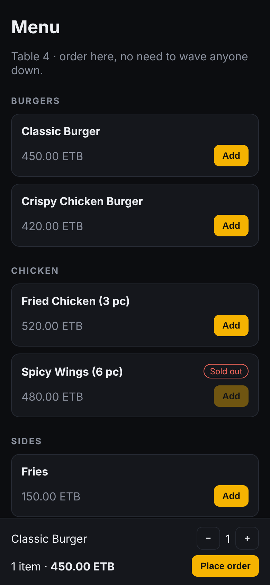
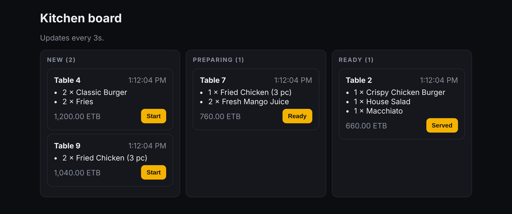

# QR Order Kit


Table-side ordering for restaurants. Guests scan a QR code at their table, order from their phone, and the kitchen sees the order on a live board, with no one flagging down a waiter.

| Guest menu | Kitchen board |
| --- | --- |
|  |  |

This is a clean, open-source rebuild of the ordering flow I've shipped for restaurants in Addis Ababa. The production version runs on a full restaurant ERP that has processed 3,552+ orders. This repo contains no client code.

## Features

- **Guest menu** (`/?table=4`): categories, sold-out items disabled, cart with quantity controls
- **Kitchen board** (`/kitchen`): New → Preparing → Ready → Served, refreshing every 3 seconds
- **Server-side pricing**: the server prices every order from the menu, so a client can't send its own prices
- **Enforced workflow**: invalid status changes (for example, New → Served) are rejected with `409`
- **Money in integer santim**, which avoids floating-point rounding errors

## Stack

Next.js 15 (App Router) · TypeScript (strict) · Zod · Vitest · Docker · GitHub Actions

## Run it

```bash
npm install
npm run dev        # http://localhost:3000/?table=4 and http://localhost:3000/kitchen
```

With Docker:

```bash
docker build -t qr-order-kit .
docker run -p 3000:3000 qr-order-kit
```

## Quality checks

```bash
npm run lint
npm run typecheck
npm test
```

CI runs all of these on every push. It also builds the Docker image and smoke-tests the running container against `/api/health`.

## API

| Method | Path | Body | Result |
| --- | --- | --- | --- |
| GET | `/api/menu` | — | Menu items |
| GET | `/api/orders` | — | All orders, oldest first |
| POST | `/api/orders` | `{ table, lines: [{ itemId, qty }] }` | `201` order · `400` invalid · `422` unavailable item |
| PATCH | `/api/orders/:id` | `{ status }` | `200` order · `404` not found · `409` invalid transition |
| GET | `/api/health` | — | `{ status: "ok" }` |

## Design notes

- The order store sits behind an `OrderStore` interface. The in-memory version can be swapped for MySQL or Postgres without touching the routes.
- Cart and pricing logic are pure functions, so they're tested without a server.
- The Docker image uses Next.js standalone output in a multi-stage build and runs as a non-root user with a health check.

## License

MIT
